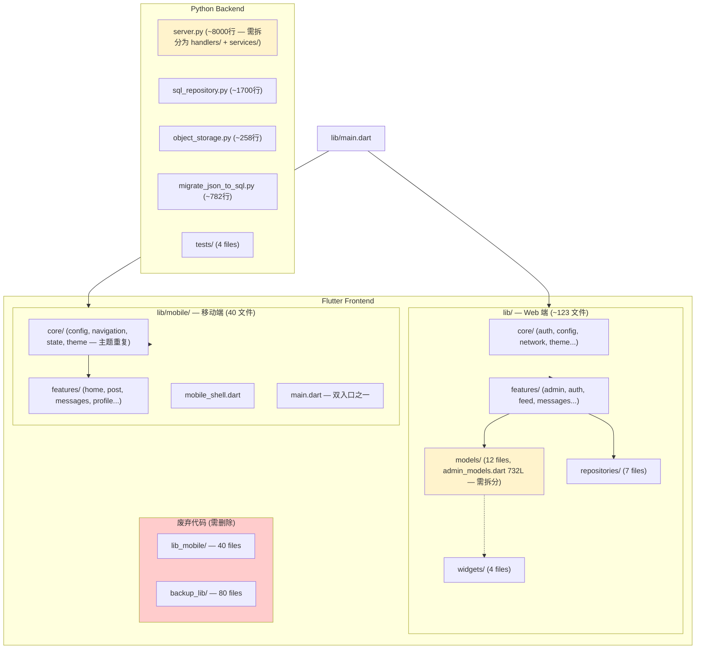

# xduWhisperBox 工程审计报告与优化方案

> 生成时间：2026-03-26
> 审计范围：Flutter 前端（lib/、lib/mobile/、lib_mobile/）+ Python 后端（backend/）+ 项目配置

---

## 一、工程概况

### 1.1 目录结构

| 路径 | 文件数 | 说明 |
|------|--------|------|
| `lib/` | ~123 | Flutter Web 前端主代码 |
| `lib/mobile/` | 40 | Flutter 移动端代码 |
| `lib_mobile/` | 40 | 根目录废弃移动端（应删除） |
| `backup_lib/` | 80 | 废弃备份目录（应删除） |
| `backend/` | 4 Python + tests | Python 后端（server.py ~8000行、sql_repository.py ~1700行） |
| `test/` | 7 | Flutter 前端测试 |
| `backend/tests/` | 4 | Python 后端测试 |
| `scripts/` | 8 | 部署与构建脚本 |
| `deploy/` | 5 | 部署配置（Nginx、systemd、env） |

### 1.2 技术栈

| 层级 | 技术 |
|------|------|
| 前端 | Flutter Web + Dart SDK >=3.3.0 <4.0.0 |
| 状态管理 | flutter_riverpod ^2.6.1 |
| HTTP | http ^1.2.2 |
| 本地存储 | shared_preferences ^2.3.2 |
| 路由（移动端） | go_router ^14.0.0 |
| 后端 | Python 3 + 标准库 HTTP 服务 |
| 数据库 | SQLite（WAL 模式） |
| 对象存储 | 本地文件 + 可选 S3 兼容 |

---

## 二、问题总览

| 严重度 | 编号 | 问题 | 涉及文件/目录 |
|--------|------|------|--------------|
| **P0** | 1 | 三套移动端代码并存（lib_mobile/ 未删除） | `lib_mobile/` 40 文件 |
| **P0** | 2 | 废弃备份目录污染仓库 | `backup_lib/` 80 文件 |
| **P0** | 3 | `backup_lib/` 中包含废弃 `dart:html` 调用 | `backup_lib/core/utils/file_download_web.dart` 等 |
| **P1** | 4 | `server.py` ~8000 行神级文件，违反单一职责 | `backend/server.py` |
| **P1** | 5 | `_handle_post()` 超过 2600 行，超大函数 | `backend/server.py` |
| **P1** | 6 | `admin_models.dart` 单文件 732 行含 15+ 模型 | `lib/models/admin_models.dart` |
| **P1** | 7 | `date_format` 依赖声明但零使用 | `pubspec.yaml` |
| **P1** | 8 | Mobile 专用依赖混入主 `pubspec.yaml` | `pubspec.yaml` |
| **P1** | 9 | 双移动端 main.dart 入口混乱 | `lib/mobile/main.dart` + `lib_mobile/main.dart` |
| **P2** | 10 | `dart:html` 废弃库使用 | `lib/core/utils/file_download_web.dart` |
| **P2** | 11 | `dart:html` 废弃库使用 | `lib/core/media/image_picker_web.dart` |
| **P2** | 12 | 主题定义重复三处 | `app_theme.dart` + 两处 `mobile_theme.dart` |
| **P2** | 13 | 后端无结构化日志，仅 `print()` | `backend/server.py` |
| **P2** | 14 | 异常信息暴露给客户端 | `backend/server.py` |
| **P2** | 15 | 生产环境 Debug 代码残留 | `backend/server.py`（`123456` 验证码） |
| **P2** | 16 | 硬编码生产 API URL | `lib/core/config/app_config.dart` |
| **P3** | 17 | 无 GitHub Actions CI/CD | 无 `.github/workflows/` |
| **P3** | 18 | 无 Docker 配置 | 无 `Dockerfile`/`docker-compose.yml` |
| **P3** | 19 | `build_runner` 可能冗余 | `pubspec.yaml` |
| **P3** | 20 | `analysis_options.yaml` 过于简单 | `analysis_options.yaml` |
| **P3** | 21 | 双套导航系统（Navigator + go_router） | `lib/` vs `lib/mobile/` |

---

## 三、详细问题分析

### P0-1：代码重复 — 三套移动端并存

**现状：** 项目中实际存在三套代码基线。

| 代码基线 | 路径 | 状态 |
|----------|------|------|
| Web 端 | `lib/` | ✅ 活跃开发 |
| 移动端（主） | `lib/mobile/` | ✅ 活跃开发 |
| 移动端（废弃） | `lib_mobile/` | ❌ 应删除但仍存在 |

`PROJECT.md` v0.1.0+6 更新日志明确记载：

> "清理重复移动端目录，删除旧 `lib_mobile/`，保留 `lib/mobile/` 作为唯一移动端源码目录"

但 `lib_mobile/` 目录仍然存在且被 git 追踪，包含完整的 40 个 Dart 文件。

**两个移动端目录结构完全相同：**
```
core/     (config, navigation, state, theme)
features/ (admin, auth, favorites, home, messages, notifications, post, profile, search, shell, widgets)
main.dart + lib_mobile.dart
```

**修复方案：**
```bash
# 确认 lib/mobile/ 是完整入口后
git rm -rf lib_mobile/
```

---

### P0-2：废弃备份目录污染仓库

`backup_lib/` 包含 80 个过时的 Dart 文件快照，是开发过程中的备份。这些文件在功能已被 `lib/` 重新实现后完全废弃，但仍被 git 追踪。

**修复方案：**
```bash
git rm -rf backup_lib/
# 在 .gitignore 中添加
echo "backup_lib/" >> .gitignore
```

---

### P1-1：后端 `server.py` 神级文件

**问题：** 单文件 ~8000 行，混合了以下所有职责：

| 功能块 | 估计行数 | 问题 |
|--------|----------|------|
| 辅助函数（密码、邮件、限流等） | ~300 | 混杂 |
| 数据库初始化/迁移 | ~600 | 混杂 |
| 序列化函数 | ~200 | 混杂 |
| GET 路由处理 | ~900 | 混杂 |
| **POST 路由处理** | **~2600** | **超大函数** |
| PATCH 路由处理 | ~500 | 混杂 |
| DELETE 路由处理 | ~200 | 混杂 |
| HTTP 服务器启动 | ~300 | 混杂 |

**重构方案：**

```
backend/
├── server.py              # ~400行：路由注册 + 服务器启动
├── sql_repository.py      # ~1700行：数据库（保持不变）
├── object_storage.py      # ~258行：对象存储（保持不变）
├── handlers/              # 新增：按域拆分 handler
│   ├── __init__.py
│   ├── auth_handler.py    # 认证相关
│   ├── post_handler.py    # 帖子相关
│   ├── comment_handler.py # 评论相关
│   ├── message_handler.py # 私信相关
│   ├── user_handler.py    # 用户相关
│   ├── notification_handler.py  # 通知相关
│   └── admin_handler.py   # 管理后台
├── services/             # 新增：业务逻辑层
│   ├── __init__.py
│   ├── post_service.py
│   ├── user_service.py
│   ├── notification_service.py
│   └── moderation_service.py
└── helpers/               # 新增：通用辅助
    ├── __init__.py
    ├── auth_helpers.py    # 密码、邮件验证
    ├── rate_limit.py      # 限流
    ├── mailer.py          # 邮件发送
    └── serialization.py   # 序列化函数
```

`_handle_post()` 的 2600 行将按端点前缀拆分为：
- `/api/auth/*` → `auth_handler.py`
- `/api/posts/*` → `post_handler.py`
- `/api/messages/*` → `message_handler.py`
- `/api/admin/*` → `admin_handler.py`

---

### P1-2：前端 `admin_models.dart` 巨型模型文件

**问题：** `lib/models/admin_models.dart` 单文件 732 行，在同一文件中定义了 15+ 个管理后台模型。

**涉及模型（估计）：**
- `AdminOverviewStats` — 仪表盘统计
- `ContentReviewItem` — 内容审核
- `ImageReviewItem` — 图片审核
- `ReportItem`（管理视图）— 举报管理
- `UserManageItem` — 用户管理
- `ChannelItem` — 频道管理
- `TagItem` — 标签管理
- `SystemSettingItem` — 系统设置
- `AnnouncementItem` — 系统公告
- `AdminAccountItem` — 管理员账号
- `AppealItem` — 申诉处理
- `CancellationRequestItem` — 注销申请
- `PinRequestItem` — 置顶申请
- `LevelRequestItem` — 等级申请
- `AuditLogItem` — 审计日志
- `ExportDataItem` — 数据导出

**重构方案：**

```
lib/models/admin/
├── admin_models.dart           # barrel file，重新导出
├── admin_overview_models.dart  # AdminOverviewStats
├── admin_review_models.dart    # ContentReviewItem, ImageReviewItem
├── admin_report_models.dart    # ReportItem
├── admin_user_models.dart      # UserManageItem, LevelRequestItem, CancellationRequestItem
├── admin_system_models.dart    # ChannelItem, TagItem, SystemSettingItem, AnnouncementItem
├── admin_account_models.dart   # AdminAccountItem
├── admin_appeal_models.dart    # AppealItem, AuditLogItem
└── admin_export_models.dart    # ExportDataItem
```

---

### P1-3：`date_format` 依赖未使用

**问题：** `pubspec.yaml` 声明了 `date_format: ^2.0.7`，但整个代码库中零处调用。

**验证结果：** 仅出现在 `pubspec.yaml`、`pubspec.lock`、`docs/mobile_development_plan.md` 中。源代码无任何 `import 'package:date_format/date_format.dart';` 或 `format()` 调用。

**修复：** 从 `pubspec.yaml` 中删除。

---

### P2-1：`dart:html` 废弃库使用

**问题：** Flutter 3.22+ 已废弃 `dart:html`，应迁移到 `package:web`。

| 文件 | 行号 | 当前导入 |
|------|------|----------|
| `lib/core/utils/file_download_web.dart` | 3 | `import 'dart:html' as html;` |
| `lib/core/media/image_picker_web.dart` | 4 | `import 'dart:html' as html;` |

**迁移方案：**

```dart
// 替换前
import 'dart:html' as html;

// 替换后（file_download_web.dart）
import 'dart:js_interop';
import 'package:web/web.dart' as web;

// 替换后（image_picker_web.dart）
import 'dart:js_interop';
import 'package:web/web.dart' as web;
```

---

### P2-2：主题定义重复三处

| 位置 | 文件 |
|------|------|
| `lib/core/theme/app_theme.dart` | Web 主题 |
| `lib/mobile/core/theme/mobile_theme.dart` | 移动端主题（应删除） |
| `lib_mobile/core/theme/mobile_theme.dart` | 废弃移动端主题（应删除） |

三处均定义相同颜色：
```dart
static const Color primary = Color(0xFF155E75);
static const Color accent = Color(0xFFE06C4E);
```

**重构方案：** `lib/mobile/core/theme/mobile_theme.dart` 改为引用 `lib/core/theme/app_theme.dart`，仅覆盖移动端特有样式（如字体大小、间距等），共享颜色常量从唯一真相源获取。

---

### P2-3：后端无结构化日志

**现状：** 仅 `print()` 语句，无日志级别区分。

```python
# 当前
print("[backend] debug verify code enabled: 123456")
print("Error occurred:", error)  # 无级别
```

**优化方案：** 使用 Python `logging` 标准库

```python
import logging

logging.basicConfig(
    level=logging.INFO,
    format='%(asctime)s [%(levelname)s] %(message)s'
)
logger = logging.getLogger(__name__)

logger.info("Server started on port %d", port)
logger.warning("Rate limit exceeded for IP %s", ip)
logger.error("Database error: %s", error)
```

---

### P2-4：异常信息暴露

**问题：** `_handle()` 在捕获所有异常后暴露内部错误：

```python
json_error(self, HTTPStatus.INTERNAL_SERVER_ERROR, f"Internal server error: {error}")
```

**优化方案：**
```python
logger.exception("Unhandled error in request %s %s", self.path, error)
json_error(self, HTTPStatus.INTERNAL_SERVER_ERROR, "Internal server error")
```

---

### P2-5：生产 Debug 代码残留

**问题：** 如果 `ALLOW_DEBUG_VERIFY_CODE=true` 或未配置 SMTP，验证码 `123456` 可被接受：

```python
if code_row.get("code") != code and not (verify_code_debug_enabled() and code == "123456"):
```

**优化：** 生产部署时强制要求环境变量 `ALLOW_DEBUG_VERIFY_CODE=false`。

---

### P2-6：硬编码生产 API URL

```dart
// lib/core/config/app_config.dart
return 'http://81.69.16.134/api';  // 应通过 --dart-define 注入
```

**优化：** 默认值应为 `''` 或 `http://localhost:8080/api`，生产值通过 `--dart-define=API_BASE_URL=https://your-domain.com/api` 注入。

---

### P3-1：无 CI/CD 自动化

**现状：** 无 GitHub Actions 流水线，无自动化测试和 lint 检查。

**优化方案：**

```yaml
# .github/workflows/dart.yml
name: Dart CI
on: [push, pull_request]
jobs:
  analyze:
    runs-on: ubuntu-latest
    steps:
      - uses: actions/checkout@v4
      - uses: dart-lang/setup-dart@v1
      - run: flutter pub get
      - run: flutter analyze
  test:
    runs-on: ubuntu-latest
    steps:
      - uses: actions/checkout@v4
      - uses: dart-lang/setup-dart@v1
      - run: flutter pub get
      - run: flutter test

# .github/workflows/python.yml
name: Python Backend CI
on: [push, pull_request]
jobs:
  test:
    runs-on: ubuntu-latest
    steps:
      - uses: actions/checkout@v4
      - run: pip install pytest
      - run: python -m pytest backend/tests/
```

---

### P3-2：`analysis_options.yaml` 过于简单

**现状：** 仅 `include: package:flutter_lints/flutter.yaml`，无自定义规则。

**优化方案：**

```yaml
include: package:flutter_lints/flutter.yaml

linter:
  rules:
    prefer_single_quotes: true
    avoid_print: true
    prefer_const_constructors: true
    avoid_unnecessary_containers: true
    prefer_interpolation_to_compose_strings: true
    prefer_collection_literals: true
    prefer_if_null_operators: true

analyzer:
  exclude:
    - build/**
    - lib_mobile/**
    - backup_lib/**
```

---

## 四、架构现状图



---

## 五、优化执行计划

### 阶段一：立即清理（P0 — 零风险，1 天）

| 序号 | 操作 | 涉及文件 |
|------|------|----------|
| **1** | 删除 `lib_mobile/` 并从 git 移除 | `lib_mobile/` 40 文件 |
| **2** | 删除 `backup_lib/` 并加入 `.gitignore` | `backup_lib/` 80 文件 |
| **3** | 从 `pubspec.yaml` 删除未使用依赖 `date_format` | `pubspec.yaml` |
| **4** | 更新 `PROJECT.md` 记录本次清理（版本历史 + 构建记录） | `PROJECT.md` |

**验证命令：**
```bash
flutter pub get
flutter analyze
```

---

### 阶段二：解耦重构（P1 — 有风险，3-5 天）

| 序号 | 操作 | 目标 |
|------|------|------|
| **5** | **后端** — `server.py` 拆分为 `backend/handlers/` + `backend/services/` + `backend/helpers/`，`server.py` 从 ~8000 行缩至 ~400 行 | `backend/server.py` → 模块化 |
| **6** | **前端** — `admin_models.dart` (732行) 拆分为 `lib/models/admin/` 子目录（5-8 个文件） | `lib/models/admin_models.dart` → `lib/models/admin/` |
| **7** | **前端** — 统一主题：移动端引用 `lib/core/theme/app_theme.dart`，删除 `lib/mobile/core/theme/mobile_theme.dart` 中的重复颜色定义 | 3 处 → 1 处 |
| **8** | **前端** — 统一移动端入口：`lib/main.dart` 为唯一入口，删除 `lib/mobile/main.dart` | 双入口 → 单一入口 |
| **9** | **后端** — 添加 Python `logging` 结构化日志系统 | `backend/server.py` |

---

### 阶段三：质量提升（P2 — 中等风险，1-2 天）

| 序号 | 操作 | 涉及文件 |
|------|------|----------|
| **10** | **前端** — 迁移 `dart:html` → `package:web` | `lib/core/utils/file_download_web.dart`<br>`lib/core/media/image_picker_web.dart` |
| **11** | **后端** — 异常信息脱敏：生产环境只返回通用错误，详细写入日志 | `backend/server.py` |
| **12** | **后端** — 生产配置清单：`deploy/tencent/backend.env.example` 添加 `ALLOW_DEBUG_VERIFY_CODE=false` 强制要求 | `deploy/tencent/backend.env.example` |
| **13** | **前端** — 完善 `analysis_options.yaml`：排除废弃目录 + 自定义 lint 规则 | `analysis_options.yaml` |
| **14** | **前端** — 评估移除冗余 `build_runner` | `pubspec.yaml` |

---

### 阶段四：工程化建设（P3 — 低风险，1-2 天）

| 序号 | 操作 | 涉及文件 |
|------|------|----------|
| **15** | 添加 GitHub Actions Dart CI（`flutter analyze` + `flutter test`） | `.github/workflows/dart.yml` |
| **16** | 添加 GitHub Actions Python CI（`pytest` 后端测试） | `.github/workflows/python.yml` |
| **17** | 添加可选 `Dockerfile` + `docker-compose.yml` | `Dockerfile`, `docker-compose.yml` |

---

## 六、TODO 清单

> 以下为 20 个可独立执行的任务单元。`- [ ]` 表示未完成，`- [x]` 表示已完成。

---

### P0 — 立即清理（零风险）

- [ ] `[TODO-01]` 删除废弃移动端目录 `lib_mobile/` 并从 git 移除
- [ ] `[TODO-02]` 删除废弃备份目录 `backup_lib/` 并加入 `.gitignore`
- [ ] `[TODO-03]` 从 `pubspec.yaml` 移除未使用的 `date_format` 依赖

---

### P1 — 解耦重构（有风险，3-5 天）

- [ ] `[TODO-11]` 后端重构：从 `server.py` 提取 `backend/handlers/` 目录（8个 handler 模块）
- [ ] `[TODO-12]` 后端重构：从 `server.py` 提取 `backend/services/` 目录（4个 service 模块）
- [ ] `[TODO-13]` 后端重构：从 `server.py` 提取 `backend/helpers/` 目录（5个 helper 模块）
- [ ] `[TODO-14]` 前端 `admin_models.dart` (732行) 拆分为 `lib/models/admin/` 子目录（8个子文件）
- [ ] `[TODO-16]` 统一移动端入口：确认 `lib/main.dart` 为唯一入口后删除 `lib/mobile/main.dart`

---

### P2 — 质量提升（中等风险，1-2 天）

- [ ] `[TODO-04]` 迁移 `lib/core/utils/file_download_web.dart` 中 `dart:html` → `package:web`
- [ ] `[TODO-05]` 迁移 `lib/core/media/image_picker_web.dart` 中 `dart:html` → `package:web`
- [ ] `[TODO-07]` 完善 `analysis_options.yaml`：排除废弃目录 + 添加自定义 lint 规则
- [ ] `[TODO-08]` 后端 `server.py` 添加 Python `logging` 结构化日志系统
- [ ] `[TODO-09]` 后端异常信息脱敏 + 完善生产配置清单 `backend.env.example`
- [ ] `[TODO-10]` 移除 `app_config.dart` 中硬编码生产 API URL，改为 `--dart-define` 注入
- [ ] `[TODO-15]` 统一主题：移动端 `mobile_theme.dart` 引用 Web `app_theme.dart`，删除重复颜色定义

---

### P3 — 工程化建设（低风险，1-2 天）

- [ ] `[TODO-06]` 评估并移除 `pubspec.yaml` 中冗余的 `build_runner`
- [ ] `[TODO-17]` 添加 GitHub Actions Dart CI（`flutter analyze` + `flutter test`）
- [ ] `[TODO-18]` 添加 GitHub Actions Python CI（`pytest` 后端测试）

---

### 文档收尾

- [ ] `[TODO-20]` 更新 `PROJECT.md`：记录所有 19 个 TODO 的执行日期、版本历史和构建记录

---

### 执行汇总表

| 编号 | 优先级 | 任务名称 | 涉及文件 |
|------|--------|----------|----------|
| 01 | P0 | 删除废弃移动端目录 | `lib_mobile/` |
| 02 | P0 | 删除废弃备份目录 + .gitignore | `backup_lib/`、`.gitignore` |
| 03 | P0 | 移除未使用 `date_format` 依赖 | `pubspec.yaml` |
| 04 | P2 | `dart:html` → `package:web`（文件下载） | `lib/core/utils/file_download_web.dart` |
| 05 | P2 | `dart:html` → `package:web`（图片选择） | `lib/core/media/image_picker_web.dart` |
| 06 | P3 | 评估并移除冗余 `build_runner` | `pubspec.yaml` |
| 07 | P2 | 完善 `analysis_options.yaml` | `analysis_options.yaml` |
| 08 | P2 | 后端添加 Python logging | `backend/server.py` |
| 09 | P2 | 后端异常信息脱敏 | `backend/server.py`、`deploy/tencent/backend.env.example` |
| 10 | P2 | 移除硬编码生产 API URL | `lib/core/config/app_config.dart` |
| 11 | P1 | 后端重构：提取 `handlers/` | `backend/server.py` → `backend/handlers/` |
| 12 | P1 | 后端重构：提取 `services/` | `backend/services/` |
| 13 | P1 | 后端重构：提取 `helpers/` | `backend/helpers/` |
| 14 | P1 | 前端 `admin_models.dart` 拆分 | `lib/models/admin_models.dart` → `lib/models/admin/` |
| 15 | P2 | 统一主题 | `lib/core/theme/app_theme.dart`、`lib/mobile/core/theme/mobile_theme.dart` |
| 16 | P1 | 统一移动端入口 | `lib/mobile/main.dart` |
| 17 | P3 | GitHub Actions Dart CI | `.github/workflows/dart.yml` |
| 18 | P3 | GitHub Actions Python CI | `.github/workflows/python.yml` |
| 20 | 文档 | 更新 `PROJECT.md` | `PROJECT.md` |