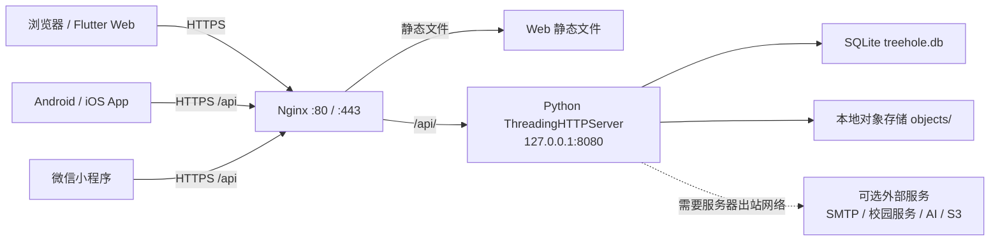

# SeeRadio 校园树洞部署清单、修复结果与离线部署规划

审计与修复日期：2026-07-17

目标环境：Ubuntu 22.04 x86-64，4 vCPU，8 GB 内存，100 GB 磁盘

计划部署根目录：`/home/ubuntu/treehole`

本报告基于当前本地仓库静态审计和本机验证生成。未连接目标服务器、未执行生产部署，也未写入任何真实域名、密码、证书或第三方密钥。

## 0. 结论与本轮修复状态

- 仓库是一套共用 Python API，加 Flutter Web、Flutter Android/iOS App、原生微信小程序三类客户端。
- 服务器实际只需运行 Python 后端和 Nginx，并持久化 SQLite 与对象文件；App 和小程序不在服务器运行。
- Flutter Web 是纯静态构建，不需要 Node.js 服务端。仓库没有 `package.json` 或 Node 锁文件。
- 推荐使用 `systemd + Nginx + Python 3.10 venv`。Docker 仅作为可选方案，离线服务器不得现场构建或拉取镜像。
- 生产域名、DNS、TLS 证书和真实凭据仍待外部信息；其余已确认的构建、打包、离线依赖、路径、配置和安全默认值问题已修复。

| 原问题 | 当前状态 |
|---|---|
| Flutter 脚本在错误目录运行、输出路径不一致 | 已修复；脚本在 `flutter_app/` 构建并复制到根目录 `build/web/` |
| release 脚本引用不存在的根目录文件并可能混入数据 | 已修复；改为运行时白名单、敏感文件扫描、SHA-256 清单及归档路径校验 |
| Dockerfile requirements 路径错误 | 已修复；改为最小运行时复制、非 root 用户和无 curl 健康检查 |
| 生产 Compose 的 Nginx 未定义、后端端口仍暴露 | 已修复；生产 Compose 可独立展开，后端不发布宿主端口，只允许预加载镜像 |
| 部署配置固定旧域名和 `/opt/xdu-whisperbox` | 已修复；运行路径统一为 `/home/ubuntu/treehole`，HTTP 配置不猜测域名 |
| systemd `ProtectHome=true` 阻断目标目录 | 已修复为 `ProtectHome=read-only`，只开放 shared 数据和对象目录写入 |
| 默认管理员密码、生产演示数据、无 SMTP 时固定验证码 | 已修复；生产启动强校验，禁止调试标志和演示数据，缺少 SMTP 时验证码接口返回不可用 |
| API Key 可放在 URL 查询参数 | 已修复；AI 模型查询只接受 POST 请求体 |
| Web/App/小程序硬编码旧生产地址 | 已修复；Web 使用同源 `/api`，App 构建和小程序本地配置必须显式注入正式 HTTPS 地址 |
| 数据导入/迁移异常被静默忽略 | 已修复；现在记录错误并中止，不再以不完整数据继续启动 |
| 离线依赖和安装流程缺失 | 已修复；新增目标架构 wheels/deb 准备、校验、安装、环境校验和回滚脚本 |

## 1. 项目架构图



生产边界应仅对公网开放 80/443。后端只监听回环地址；80 在证书可用后重定向到 443。

## 2. 仓库结构与分类

### 2.1 一级目录

| 路径 | 分类 | 说明 |
|---|---|---|
| `.git/` | 版本控制 | Git 历史和元数据，不属于部署内容 |
| `backend/` | 共用后端、数据库 | Python API、SQLite Repository、对象存储、迁移工具和测试 |
| `deploy/` | 部署配置 | systemd、Nginx、生产环境变量模板 |
| `flutter_app/` | 网页端、App、共享前端库 | 同一 Flutter 工程构建 Web、Android 和 iOS |
| `miniprogram/` | 小程序端 | 原生微信小程序源码 |
| `offline/` | 离线部署材料 | Git 中只保留说明；实际 wheels/deb 包在外部构建后放入此处 |
| `scripts/` | 构建、校验和运维工具 | Web 构建、release 打包、离线安装、环境校验、健康检查和回滚 |

根目录另有 `Dockerfile`、开发/生产 Compose、`render.yaml`、项目文档、Windows 启动脚本和忽略规则。`build/`、`dist/`、`.venv/`、`.pytest_cache/` 是本机生成内容，不是源码目录。

### 2.2 关键二级目录

| 路径 | 分类 | 用途 | 生产服务器是否需要 |
|---|---|---|---|
| `backend/handlers/` | 后端 | HTTP 认证、帖子、评论、消息、上传、AI、管理接口 | 是 |
| `backend/helpers/` | 后端共享库 | HTTP、认证、邮件、限流、校园服务适配 | 是 |
| `backend/services/` | 后端共享库 | 业务和数据库状态服务 | 是 |
| `backend/sql/` | 数据库工具 | 历史 JSON 到 MySQL/PostgreSQL 的非完整迁移 schema | 否 |
| `backend/data/` | 本地用户数据 | SQLite、WAL、SHM | 禁止随 release 上传；服务器单独建立 shared 数据目录 |
| `backend/storage/` | 本地对象数据 | 上传对象 | 禁止随 release 上传；服务器单独建立 shared 对象目录 |
| `backend/tests/` | 测试 | pytest 测试 | 否 |
| `deploy/production/` | 部署配置 | 环境模板、容器 Nginx、HTTPS 模板、缓存片段 | 选定文件需要 |
| `deploy/tencent/` | 部署配置 | 兼容旧文件名的 Ubuntu systemd/Nginx/env 模板 | 选定文件需要 |
| `flutter_app/lib/` | Web/App 共享库 | UI、模型、Repository、网络层；`lib/mobile/` 为移动界面 | 仅构建机需要 |
| `flutter_app/web/` | 网页端 | Flutter Web 外壳 | 仅构建机需要 |
| `flutter_app/android/` | App 端 | Gradle/Android 工程 | 仅 Android 构建机需要 |
| `flutter_app/ios/` | App 端 | Xcode/CocoaPods 工程 | 仅 macOS/iOS 构建机需要 |
| `flutter_app/test/` | 测试 | Flutter 测试 | 否 |
| `miniprogram/api/` | 小程序共享库 | API 封装 | 仅微信开发者工具需要 |
| `miniprogram/config/` | 小程序配置 | 环境选择；正式域名放在被忽略的本地配置中 | 仅微信开发者工具需要 |
| `miniprogram/pages/` | 小程序端 | 页面 | 否 |
| `miniprogram/components/` | 小程序共享库 | 组件 | 否 |
| `miniprogram/utils/` | 小程序共享库 | 请求、认证、主题、格式化 | 否 |

## 3. 各组件技术栈、命令和输出

| 组件 | 技术栈 | 包管理器/锁文件 | 启动命令 | 构建命令 | 输出 |
|---|---|---|---|---|---|
| 共用后端 | Python 3，`ThreadingHTTPServer`，SQLite | pip；`requirements-storage.txt`、`requirements-test.txt`；外部 DB 工具另用 `requirements-db.txt` | 显式设置管理员密码后运行 `python3 backend/server.py`；生产由 systemd 启动 | 无编译 | Python 源码；运行时创建 DB/对象目录 |
| Flutter Web | Flutter/Dart | Flutter pub，`pubspec.yaml`、`pubspec.lock` | `cd flutter_app && flutter run -d chrome` | `FLUTTER_BIN=/path/to/flutter bash scripts/build_web_production.sh` | 根目录 `build/web/`；Flutter 原始输出 `flutter_app/build/web/` |
| Android App | Flutter、Gradle 8.14、AGP 8.11.1、Kotlin 2.2.20、JDK 17 | Flutter pub + Gradle | `cd flutter_app && flutter run` | `flutter build apk --release --dart-define=MOBILE_API_BASE_URL=https://<域名>/api` | `flutter_app/build/app/outputs/` |
| iOS App | Flutter、Xcode、CocoaPods | Flutter pub + CocoaPods | `cd flutter_app && flutter run` | `flutter build ipa --release --dart-define=MOBILE_API_BASE_URL=https://<域名>/api` | `flutter_app/build/ios/` 及 Xcode 归档 |
| 微信小程序 | 原生 JS/WXML/WXSS/JSON | 无 npm/yarn/pnpm 清单 | 微信开发者工具导入 `miniprogram/` | 微信开发者工具预览/上传 | 微信平台管理，无服务器产物 |
| 数据库 | SQLite 在线 Repository | Python 标准库 `sqlite3` | 随后端启动 | 启动时 `CREATE TABLE IF NOT EXISTS` 和补列 | `BACKEND_DB_FILE` 指定文件 |
| 发布 | Bash、Python 校验器、Nginx、systemd | 无额外包管理器 | systemd/Nginx | `bash scripts/package_release.sh` | `dist/treehole-<version>.tar.gz` |

Web 构建是 `index.html`、JavaScript、WASM/CanvasKit、字体和资源文件的纯静态站点；服务器不需要 Node.js、Flutter SDK 或 Dart SDK。

## 4. Docker、Compose、Nginx、迁移和环境模板

| 类型 | 路径 | 当前用途和状态 |
|---|---|---|
| Docker | `Dockerfile` | Python 3.10 slim；安装运行依赖，使用非 root 用户；构建仍需联网，因此只能在联网构建机生成 `linux/amd64` 镜像 |
| Docker 忽略 | `.dockerignore` | 排除 Git、本地 DB/对象、env、证书、缓存、测试和前端源码 |
| 开发 Compose | `docker-compose.yml` | 仅将 8080 绑定到 `127.0.0.1`；要求显式管理员账号密码 |
| 生产 Compose | `docker-compose.prod.yml` | 仅使用预加载镜像；后端无宿主端口；Nginx 暂只开放 80，域名/证书完成后再启用 443 配置 |
| HTTP Nginx | `deploy/tencent/nginx-xdu-whisperbox.conf` | 与域名无关，根目录 `/home/ubuntu/treehole/current/web`，代理回环 8080 |
| HTTPS 模板 | `deploy/production/nginx-treehole-https.conf.template` | 通过 `scripts/render_nginx_https.py` 写入正式域名和证书绝对路径 |
| 容器 Nginx | `deploy/production/nginx-container.conf` | Compose 内部代理 `backend:8080` |
| systemd | `deploy/tencent/xdu-whisperbox.service` | 安装脚本将其安装为 `/etc/systemd/system/treehole.service` |
| 生产 env 模板 | `deploy/tencent/backend.env.example`、`deploy/production/.env.example` | 均为占位模板，不含真实凭据 |
| 兼容 env 文件 | `deploy/tencent/xdu-whisperbox.env` | 仅保留兼容模板并明确禁止填真实秘密；release 白名单不包含它 |
| SQLite schema 演进 | `backend/sql_repository.py` | 当前在线服务唯一有效 schema 和补列逻辑 |
| 历史外部 DB schema | `backend/sql/schema_mysql.sql`、`schema_postgresql.sql` | 只供历史 JSON 迁移评估，不覆盖当前完整在线模型，不进入 release |
| 历史迁移脚本 | `backend/migrate_json_to_sql.py` | JSON 到 MySQL/PostgreSQL；不是在线后端切换方案 |
| Render | `render.yaml` | 公网云平台草案；不用于本次离线 Ubuntu 部署 |

## 5. 服务器实际需要部署的组件和目录

### 5.1 必须运行

1. Nginx：提供 `current/web`，并把 `/api/` 代理到 `127.0.0.1:8080`。
2. Python 3.10 后端：运行 release 中的 `backend/server.py`。
3. SQLite 持久化目录：`shared/data/`。
4. 本地对象持久化目录：`shared/storage/objects/`；若明确改用 S3/OSS，则改为相应凭据和网络策略。
5. 受保护环境文件：`shared/config/backend.env`，权限 `0640 root:treehole`。
6. 离线 Python venv：`shared/venv/`，必须在目标 Linux 上从目标 wheels 创建。

### 5.2 推荐目录结构

```text
/home/ubuntu/treehole/
├── current -> releases/20260717T...Z/
├── releases/
│   └── 20260717T...Z/
│       ├── backend/
│       ├── web/
│       ├── deploy/
│       ├── scripts/
│       ├── release-meta/
│       └── RELEASE-MANIFEST.sha256
├── shared/
│   ├── config/backend.env
│   ├── data/treehole.db
│   ├── storage/objects/
│   └── venv/
├── offline/
│   ├── wheels-cp310-manylinux-x86_64/
│   └── ubuntu2204-amd64-debs/
└── backups/
    ├── sqlite/
    └── storage/
```

`current` 切换与 shared 数据分离，允许代码回滚而不覆盖数据库。安装前仍需在目标机确认 Nginx worker 可以遍历 `/home/ubuntu`；不应为了可读性开放 shared 配置或数据目录。

## 6. 上传、本地构建和排除清单

### 6.1 必须上传

| 内容 | 目标/用途 |
|---|---|
| `dist/treehole-<version>.tar.gz` | 后端运行源码、Web 静态产物、部署模板和受控运维脚本 |
| `offline/wheels-cp310-manylinux-x86_64/` 及 `SHA256SUMS` | Python 3.10 Linux x86-64 离线安装 |
| `offline/ubuntu2204-amd64-debs/` 及 `SHA256SUMS` | 缺失系统包的离线安装；需与目标 Ubuntu 22.04 包状态匹配 |
| `scripts/install_offline_debs.sh` | 在目标机校验并安装 deb |
| `scripts/install_ubuntu_offline.sh` 和 `scripts/validate_production_env.py` | 解包、建 shared 目录/venv、安装 systemd/Nginx、校验和回滚 |
| release 压缩包的独立 SHA-256 值 | WinSCP/SFTP 上传后先核验传输完整性；应通过独立可信渠道保存/核对 |

真实 `backend.env` 和 TLS 私钥不应放入通用 release 压缩包。它们只应单独写入目标机受保护位置。

### 6.2 仅开发使用，不应上传

- `.git/`、`.venv/`、`.pytest_cache/`、IDE 文件、`.DS_Store`、项目内部说明。
- `backend/tests/`、`backend/requirements-test.txt`、`flutter_app/test/`。
- `backend/data/`、`backend/storage/`、任何 `*.db`、`*.db-wal`、`*.db-shm`。
- 所有 `__pycache__/`、`*.pyc`、Flutter `.dart_tool/`、Gradle/CocoaPods 缓存。
- `flutter_app/`、`miniprogram/` 源码；服务器只需已经构建的 `web/`。
- `miniprogram/config/env.local.js`、`project.private.config.json`。
- `.env`、真实生产 env、TLS 私钥、云凭据、Android/iOS 签名材料。
- `*.log`、coverage、临时文件、旧 `build/` 和旧 `dist/`。只使用本轮重新生成并验证的 release。

release 脚本目前只复制后端运行时白名单、`web/`、选定部署配置和运维脚本，并拒绝 DB、私钥、签名文件、日志、字节码和常见令牌格式。

### 6.3 App 和小程序的服务器运行时依赖

- Android/iOS App 没有服务器本地运行时依赖；用户设备通过 HTTPS 调用同一 API。
- 微信小程序没有服务器本地运行时依赖；由微信客户端和平台运行。
- 服务器不需要 Android SDK、Gradle、JDK、Xcode、CocoaPods、微信开发者工具或前端源码。
- 正式域名确定后，App 要以 `MOBILE_API_BASE_URL` 重建；小程序要填写被 Git 忽略的 `env.local.js`，并在微信公众平台登记 request/upload/download 合法域名。

### 6.4 应在本地构建后上传

- Flutter Web：可在 macOS ARM 构建并上传静态产物，使用同源 `/api`，与 Linux CPU 无关。
- Android APK/AAB：在本地 Android 构建机按目标 ABI 构建并签名，通过 App 渠道分发，不在服务器运行。
- iOS IPA：必须在 macOS/Xcode 环境签名并经 Apple 渠道分发，不在服务器运行。
- 微信小程序：通过微信开发者工具上传，不通过 Ubuntu 服务器发布。

### 6.5 必须在 Linux x86-64 兼容环境准备

- CPython 3.10 的 Linux x86-64 wheels，尤其是 Pillow；可选外部 DB 工具的 `psycopg[binary]` 同样与平台相关。
- Ubuntu 22.04 amd64 的 deb 和全部传递依赖。
- 如选 Docker，完整镜像必须在联网环境构建为 `linux/amd64`，再 `docker save`/SFTP/`docker load`。
- 没有 manylinux wheel 的 Python 包必须在兼容 Ubuntu 22.04 x86-64 构建机编译 wheel。

不能从 macOS ARM 复制到服务器：`.venv/`、Pillow/psycopg 等本机 wheel 或已安装扩展、`*.dylib`、macOS 可执行文件、CPython 3.14 字节码、Flutter/Gradle/CocoaPods 缓存，以及未指定 `linux/amd64` 的本地 Docker 镜像。

## 7. 安全审计

以下只列路径和风险类别，不记录任何秘密实际内容。

| 检查项 | 结果 | 路径与风险 |
|---|---|---|
| `.env` 和生产密码 | 未发现真实生产 env；存在模板 | `deploy/production/.env.example`、`deploy/tencent/backend.env.example`、兼容模板 `deploy/tencent/xdu-whisperbox.env`；后者不进入 release |
| 默认管理员密码 | 已消除不安全默认启动 | `backend/_globals.py` 强制显式密码，生产要求至少 12 位并拒绝已知模板；`backend/server.py` 不再打印密码 |
| 数据库密码 | 未发现实际密码 | 当前在线服务为 SQLite；README 和模板中的外部 DB 连接仅是示例 |
| JWT 密钥 | 未发现 | 当前认证使用数据库 session token，不使用 JWT；因此 SQLite 备份本身包含会话敏感性 |
| 微信 AppSecret | 未发现 | `miniprogram/project.config.json` 仅有公开 AppID；未发现 AppSecret |
| 第三方 API Key | 未发现仓库内实际 Key；存在用户端保存/后端转发能力 | `flutter_app/lib/features/ai/ai_page.dart`、`miniprogram/api/ai.js`、`backend/handlers/_ai_handler.py`；已禁止 Key 放 URL，仍必须全程 HTTPS 且不得记录请求体 |
| App 签名证书 | 未发现实际证书 | `flutter_app/android/key.properties.example` 是模板，`android/keystore/` 仅有 `.gitkeep`；未发现 JKS、keystore、p12、provisioning profile |
| 私钥 | 未发现 | 未发现 PEM 私钥头或私钥文件；TLS 私钥必须独立放服务器证书目录 |
| 云存储凭据 | 未发现实际凭据 | `deploy/production/.env.example` 和 `backend/object_storage.py` 只有配置入口 |
| 硬编码生产服务器地址 | 旧主地址已移除 | `flutter_app/lib/core/config/app_config.dart` 改为 Web 同源和移动端显式注入；`miniprogram/config/env.js` 要求本地正式配置 |
| 硬编码本地地址 | 存在于被忽略的本地配置 | `miniprogram/config/env.local.js`；不得上传或提交 |
| 外部校园地址 | 仍有静态上游地址，部分为 HTTP | `backend/helpers/_xidian_auth.py`、`backend/helpers/_campus_auth.py`、`backend/services/_db_service.py` 及校园前端页面；没有可确认的 HTTPS 上游替代地址，不能凭空修改 |
| 用户数据/测试数据库 | 存在，性质待项目方确认 | `backend/data/treehole.db`、`.db-wal`、`.db-shm`；含用户、帖子、评论、会话、私信等记录，禁止进入 release，也未在本轮修改 |
| 本地对象数据 | 当前目录存在 | `backend/storage/objects/`；无论当前是否为空，都按持久化数据排除 |
| 日志 | 当前未发现应用日志进入 release | Git 历史曾有后端日志路径；公开历史前应单独做 Git 历史秘密扫描 |
| 缓存/构建残留 | 本机存在但已忽略且 release 排除 | Python `__pycache__`、Flutter `.dart_tool/`/`build/`、`.pytest_cache/`、`dist/` |
| 调试验证码 | 生产已封闭 | `backend/_globals.py` 和 `_auth_handler.py`：生产拒绝调试开关；无 SMTP 且未显式开发调试时返回 503 |
| 演示数据 | 生产已封闭 | `backend/services/_db_service.py`：生产 `BACKEND_SEED_DEMO_DATA=false` 时新库为空 |

当前 SQLite 使用过 WAL 文件。若未来决定迁移本地数据，不能在后端写入期间只复制主 `.db`；应停止写入后 checkpoint/backup，或使用 SQLite 在线备份 API 获取一致快照。

## 8. 离线部署依赖问题与推荐方式

### 8.1 依赖结论

- Ubuntu 22.04 默认目标 Python 应为 CPython 3.10；本地验证环境为 macOS ARM/CPython 3.14，不能复制其 venv。
- `requirements-storage.txt` 包含 `requests`、Pillow、`boto3`。Pillow 有平台原生扩展；其余依赖也应统一从目标 wheel 包安装，避免混用平台文件。
- 服务器无法访问公网时，SMTP、校园认证/校园服务、用户自定义 AI 服务、S3/OSS 同样不可用，除非服务器有相应内网路由或精确出站白名单。离线安装成功不代表这些业务上游可达。
- `prepare_offline_debs_ubuntu2204.sh` 必须在联网的 Ubuntu 22.04 amd64 主机运行。目标机若已有部分不同版本包，仍需在上线前用同版本快照做一次隔离环境安装演练。

### 8.2 推荐部署方式

首选原生部署：Nginx + systemd + Python 3.10 venv。

原因：当前服务结构简单，4 vCPU/8 GB 足够运行单实例和 Nginx；原生方式的离线包、持久化路径和日志更透明，避免额外准备 Docker Engine 及两套 OCI 镜像。当前 `ThreadingHTTPServer` 是单进程多线程，实际并发容量仍需上线前压测，不能仅根据硬件推断。

建议顺序：

1. 在联网 Ubuntu 22.04 amd64 构建机生成 wheels/deb，并验证 `SHA256SUMS`。
2. 在本地 Flutter 构建机生成 Web 和 release；从干净提交重新构建正式包并记录独立 SHA-256。
3. 用干净的 Ubuntu 22.04 amd64 虚拟机断网演练 deb、wheel、安装、启动、回滚和备份恢复。
4. WinSCP/SFTP 上传到目标机，先校验 hash，再安装；不要在目标机执行联网 `apt`、`pip`、`docker pull` 或 Flutter 构建。
5. 域名和证书到位后渲染 HTTPS Nginx 配置，先 `nginx -t`，再切换 443。

Docker 备选方式必须预先 `docker save` 后端 `linux/amd64` 镜像和 Nginx 镜像；目标机仅 `docker load` 和 Compose 启动。

## 9. 当前仍缺少的信息

1. 正式域名、DNS 解析、生效时间、TLS 证书链/私钥路径及续期方式。
2. 目标服务器现有软件和包版本清单；目前不能确定是否需要完整 deb 集合或仅补少量包。
3. 服务器对 SMTP、校园服务、AI Provider、S3/OSS 的出站网络策略。服务器完全无公网时，这些功能会不可用。
4. 正式 SMTP 服务、发件地址和授权方式。
5. 对象存储最终选型：本地磁盘还是 S3/OSS；对应容量、生命周期和备份要求。
6. 当前本地 SQLite 是测试数据还是需迁移的正式数据；本轮没有读取或输出字段值，也没有修改它。
7. RPO/RTO、备份保留周期、异地备份位置、恢复演练要求。
8. 预计并发、峰值请求、图片增长量和日志保留要求；用于容量与压测标准。
9. Android/iOS 签名与分发主体、微信小程序合法域名备案和发布主体。
10. 最终选择原生 systemd 还是离线 Docker；本报告推荐原生 systemd。

## 10. 下一阶段具体操作计划

### 域名申请期间

1. 在联网 Ubuntu 22.04 amd64 构建机生成并冻结 wheels/deb 离线包。
2. 建立同版本断网虚拟机，完整演练安装、环境校验、空库启动、文件上传、重启、回滚与恢复。
3. 确认本地 SQLite 是否迁移；若迁移，单独制定一致性备份和脱敏验收，不混入 release。
4. 确认 SMTP、校园服务和对象存储出站地址/端口，形成最小白名单。
5. 确定备份策略并验证 SQLite 与对象目录成对恢复。

### 域名与证书到位后

1. 使用 `scripts/render_nginx_https.py` 生成正式 Nginx 配置，不手工替换未校验字符串。
2. 填写目标机 `shared/config/backend.env`，运行 `validate_production_env.py`；秘密不回传仓库。
3. 从干净 Git 提交重新构建 Web 和 release，记录版本和独立 SHA-256。
4. 使用正式域名重建 Android/iOS App，并更新小程序被忽略的本地生产配置及微信合法域名。
5. 在维护窗口执行 SFTP 上传、hash 校验、离线安装；运行 `nginx -t`、systemd 状态和 `/api/health` 检查。
6. 执行 API、注册邮件、上传、登录、管理端、小程序/App 的端到端验收，再开放公网流量。
7. 立即做首次备份与恢复抽查，记录上线版本、配置校验结果和回滚点。

## 11. 本机验证记录

- `git diff --check`：通过。
- 所有 Bash 脚本 `bash -n`：通过。
- 修改的 Python 文件 `py_compile`：通过。
- 后端 pytest：101 项通过。
- Flutter `analyze`：无问题。
- Flutter 测试：87 项通过。
- Flutter Web production 构建：通过，生成约 32 MB 静态产物。
- release 白名单打包：通过，生成约 11 MB 本地验证归档；因当前修复尚未提交，验证时显式使用 `ALLOW_DIRTY_RELEASE=1`，正式打包默认拒绝 dirty worktree。
- release 路径安全、成员类型和 SHA-256 清单验证：通过。
- 开发 Compose 和离线生产 Compose `docker compose config`：通过。
- 本机生产配置冒烟测试：`/api/health` 返回健康；新 SQLite 中用户、帖子、评论、会话计数均为 0。
- Docker 镜像实际构建：未执行；本机 Docker daemon 未运行，且镜像构建需要联网。上线前必须在联网 `linux/amd64` 构建机验证，或采用推荐的原生 systemd 路线。
- Nginx 实际 `nginx -t`：本机未安装 Nginx；需在 Ubuntu 22.04 断网演练机和目标机切换前各执行一次。
